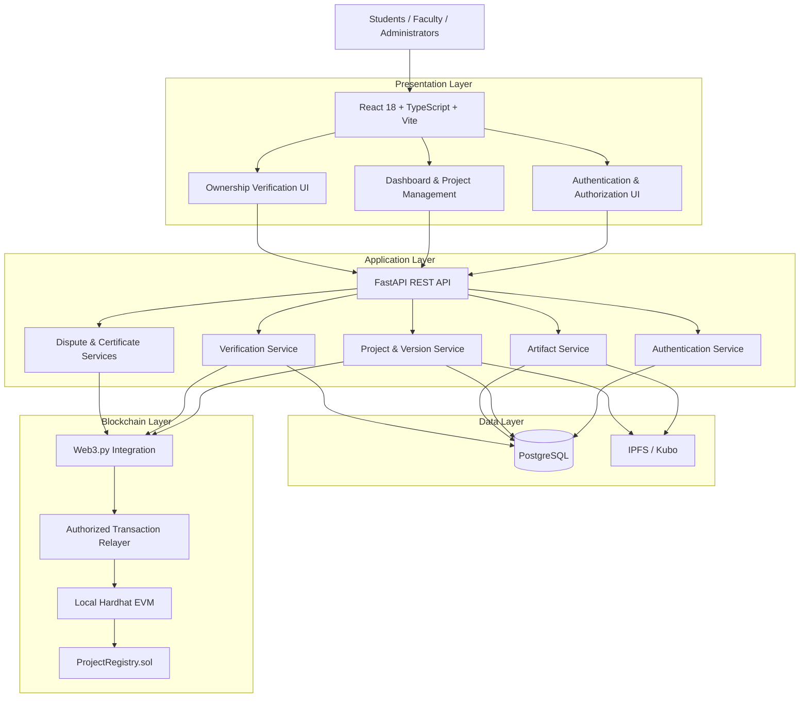
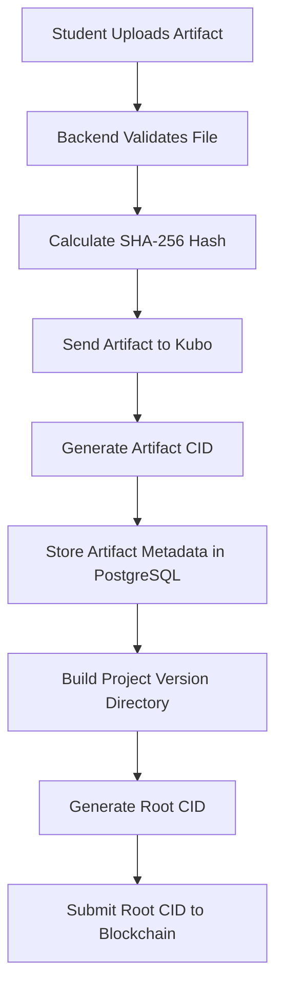
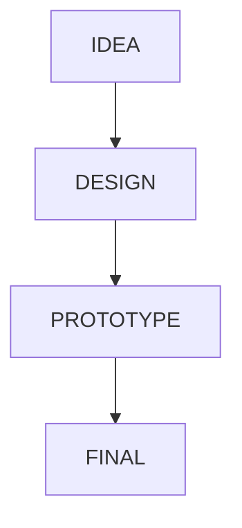
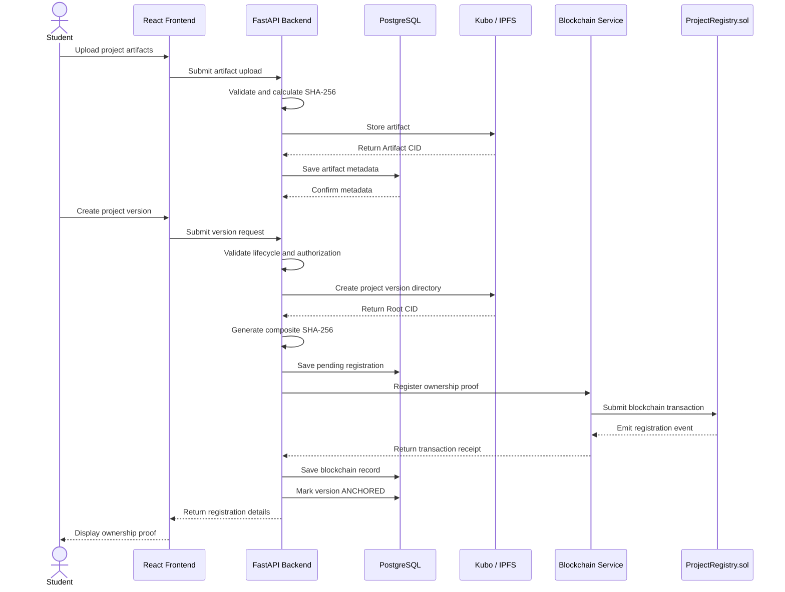
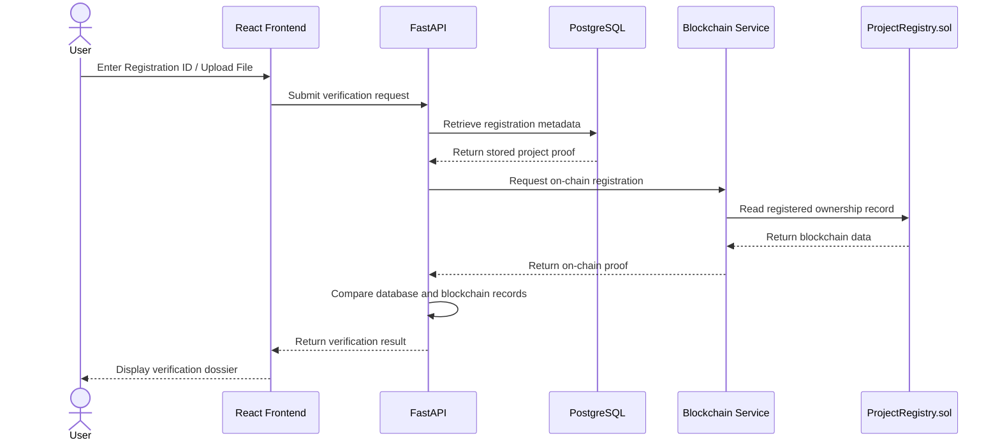
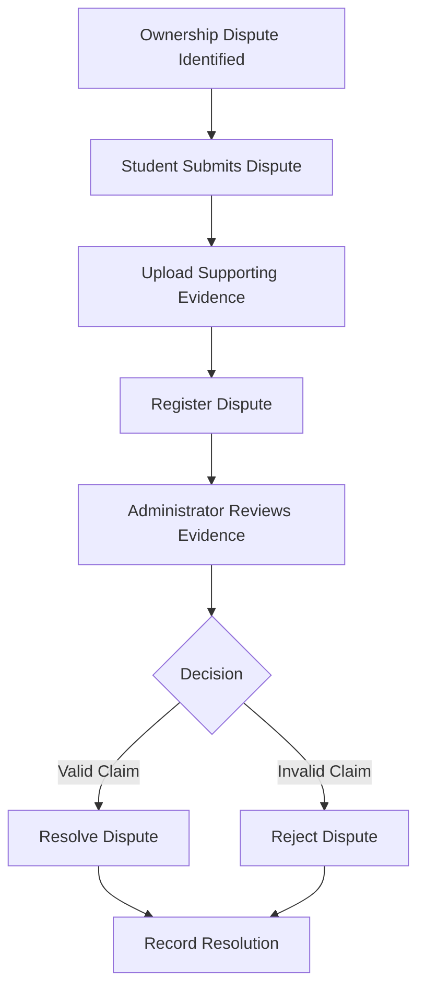

# 🔗 Blockchain-Based Student Project Ownership Registry

### A Decentralized Platform for Student Project Ownership, Intellectual Property Protection, and Verifiable Digital Proof


---

## 📌 Table of Contents

1. [Project Overview](#-project-overview)
2. [Problem Statement](#-problem-statement)
3. [Proposed Solution](#-proposed-solution)
4. [Project Objectives](#-project-objectives)
5. [Key Features](#-key-features)
6. [System Architecture](#-system-architecture)
7. [Technology Stack](#-technology-stack)
8. [System Design](#-system-design)
9. [Blockchain Architecture](#-blockchain-architecture)
10. [IPFS Integration](#-ipfs-integration)
11. [Project Lifecycle](#-project-lifecycle)
12. [Ownership Registration Workflow](#-ownership-registration-workflow)
13. [Ownership Verification Workflow](#-ownership-verification-workflow)
14. [Dispute Management](#-dispute-management)
15. [Ownership Certificate Generation](#-ownership-certificate-generation)
16. [Database Design](#-database-design)
17. [API Architecture](#-api-architecture)
18. [Security Architecture](#-security-architecture)
19. [User Roles](#-user-roles)
20. [Project Structure](#-project-structure)
21. [Installation and Setup](#-installation-and-setup)
22. [Running the Project](#-running-the-project)
23. [Testing](#-testing)
24. [Expected System Output](#-expected-system-output)
25. [Advantages](#-advantages)
26. [Future Enhancements](#-future-enhancements)
27. [Contributors](#-contributors)
28. [License](#-license)

---

## 📖 Project Overview

The **Blockchain-Based Student Project Ownership Registry** is a decentralized application designed to protect and establish verifiable ownership of academic projects, research work, software applications, prototypes, designs, and other intellectual creations developed by students.

In academic institutions, students frequently develop innovative projects and research solutions. However, proving the originality, ownership, and creation timeline of these projects can be challenging.

Traditional documentation systems generally depend on centralized databases and manually maintained records. These records may be modified, lost, duplicated, or disputed.

Our platform addresses this problem by combining **Blockchain Technology, IPFS (InterPlanetary File System), Cryptographic Hashing, and a Centralized Metadata Management System**.

The platform allows students to:

- Register their project ideas and intellectual creations.
- Upload project documents, designs, source-code archives, and prototypes.
- Generate cryptographic fingerprints of submitted artifacts.
- Store digital artifacts using IPFS.
- Record immutable ownership proofs on a blockchain.
- Track project development through multiple milestones.
- Verify ownership and authenticity independently.
- Raise disputes in cases of plagiarism or unauthorized usage.
- Generate verifiable ownership certificates.

The system maintains project metadata and application records in PostgreSQL while using blockchain technology for tamper-resistant ownership evidence and IPFS for decentralized artifact storage.

**Our primary objective is to establish a transparent, secure, and verifiable digital ownership registry for student innovations.**

---

## 🚨 Problem Statement

Students and academic institutions face several challenges when managing intellectual property and project ownership.

### 1. Lack of Verifiable Ownership

Students may struggle to prove that they developed a particular project before another individual or team.

### 2. Intellectual Property Theft

Project ideas, source code, designs, and prototypes can be copied or reused without proper authorization or acknowledgment.

### 3. Centralized Record Management

Traditional systems store ownership records in centralized databases, making them dependent on a single authority.

### 4. Difficulty in Establishing Timelines

There is often no independently verifiable mechanism to establish when a project idea, design, or prototype was registered.

### 5. Lack of Transparent Dispute Resolution

Institutions may find it difficult to investigate ownership disputes because supporting evidence and historical records are not maintained in a standardized manner.

### 6. No Standardized Ownership Verification

Third parties, evaluators, institutions, and organizations need a reliable way to verify the authenticity and ownership history of academic projects.

---

## 💡 Proposed Solution

We propose a blockchain-powered ownership registry that creates a tamper-resistant digital record for every registered project.

The platform works through the following process:

1. A student creates an account and registers a project.
2. The student uploads project-related documents or other digital artifacts.
3. The system calculates cryptographic SHA-256 hashes of the uploaded artifacts.
4. Artifacts are stored using IPFS, generating unique Content Identifiers (CIDs).
5. A deterministic composite hash is generated for the project version.
6. Project metadata and storage references are maintained in PostgreSQL.
7. The composite hash, IPFS root CID, registration details, and ownership information are submitted to a Solidity smart contract.
8. The blockchain records a timestamped ownership proof.
9. The student receives a registration identifier and transaction reference.
10. Anyone with the appropriate registration information can verify the ownership proof.

The blockchain acts as the tamper-resistant proof layer, while IPFS provides decentralized content storage and PostgreSQL supports application-level data management.

---

## 🎯 Project Objectives

- Establish verifiable ownership of student projects.
- Prevent unauthorized modification of registered ownership proofs.
- Provide timestamp-based evidence of project registration.
- Maintain project development and milestone history.
- Enable cryptographic verification of uploaded artifacts.
- Provide decentralized storage through IPFS.
- Support transparent dispute registration and resolution.
- Generate digitally verifiable ownership certificates.
- Provide a unified platform for students, institutions, and administrators.

---

## ✨ Key Features

### 1. User Authentication and Authorization

- Student registration and login.
- Secure password hashing using Argon2id.
- JWT-based authentication.
- Protected application routes.
- Role-based access control.

### 2. Project Management

- Create and manage academic projects.
- Maintain project descriptions and metadata.
- View project details and ownership information.
- Manage project team members.
- Support student, contributor, and faculty mentor roles.

### 3. Artifact Management

- Upload project documents and digital files.
- Validate file types and file sizes.
- Calculate SHA-256 file hashes.
- Maintain artifact metadata.
- Store artifacts using the configured storage abstraction and IPFS integration.

### 4. Project Versioning and Milestones

The platform supports four project lifecycle stages:

- IDEA
- DESIGN
- PROTOTYPE
- FINAL

Students can register project versions and associate relevant artifacts with each milestone.

Each version maintains its own ownership proof and historical record.

### 5. Blockchain-Based Ownership Registration

- Generate a deterministic composite SHA-256 hash.
- Store IPFS root CID references.
- Register ownership details through Solidity smart contracts.
- Record blockchain transaction hashes.
- Maintain timestamped registration evidence.
- Support authorized relayer transactions.

### 6. Ownership Verification

Users can verify project ownership using:

- Public registration ID.
- SHA-256 hash.
- Uploaded digital file.

The verification system compares available database metadata and blockchain records to determine whether the submitted information matches the registered ownership proof.

### 7. Dispute Management

- Register ownership disputes.
- Submit supporting evidence.
- Maintain dispute status and history.
- Record dispute information on-chain.
- Support administrator adjudication.
- Preserve the original ownership proof even after dispute resolution.

### 8. Ownership Certificates

- Generate ownership certificate information.
- Provide certificate verification details.
- Display QR-based verification using the server-provided verification URL.
- Support certificate PDF download.

### 9. Dashboard and Administration

- Project overview.
- Project and milestone tracking.
- Artifact management.
- Ownership verification.
- Dispute management.
- Administrative dispute adjudication.

---

# 🏗️ System Architecture

The system follows a modular, layered architecture in which the frontend, backend, database, blockchain, and decentralized storage operate as separate components.

### High-Level Architecture



### Architecture Explanation

**1. Presentation Layer**

Built using React, TypeScript, Vite, and Tailwind CSS.

It provides the user interface for authentication, project management, artifact uploads, milestone management, verification, certificates, and disputes.

**2. Application Layer**

Built using FastAPI and Python.

It handles business logic, API requests, authentication, authorization, project management, file processing, IPFS communication, blockchain integration, and verification.

**3. Data Layer**

Uses PostgreSQL for structured application data and IPFS for decentralized storage of digital artifacts.

**4. Blockchain Layer**

Uses Solidity smart contracts deployed on an EVM-compatible network. Web3.py connects the backend to the blockchain and submits authorized transactions through a relayer.

---

# 🛠️ Technology Stack

| Layer | Technology | Purpose |
|---|---|---|
| Frontend | React 18 | User interface |
| Language | TypeScript | Type-safe frontend development |
| Build Tool | Vite | Frontend development and build |
| Styling | Tailwind CSS | Responsive UI |
| Routing | React Router | Client-side navigation |
| HTTP Client | Axios | Backend communication |
| Backend | FastAPI | REST API and business logic |
| Backend Language | Python | Application development |
| ORM | SQLAlchemy 2.0 | Database interaction |
| Migrations | Alembic | Database schema management |
| Database | PostgreSQL 16 | Structured data storage |
| Authentication | JWT | Secure API authentication |
| Password Security | Argon2id | Password hashing |
| Blockchain | Ethereum-compatible EVM | Ownership proof |
| Smart Contracts | Solidity 0.8.24 | On-chain ownership registry |
| Blockchain Framework | Hardhat | Contract development and testing |
| Blockchain Integration | Web3.py | Backend blockchain communication |
| Web3 Library | Ethers.js 6 | Blockchain development tooling |
| Decentralized Storage | IPFS / Kubo | Digital artifact storage |
| Cryptography | SHA-256 | File and composite hashing |
| Testing | Pytest | Backend testing |
| Testing | Vitest | Frontend testing |
| Smart Contract Testing | Hardhat / Mocha / Chai | Blockchain testing |
| Containerization | Docker Compose | Local infrastructure services |
| Version Control | Git & GitHub | Source-code management |

---

# ⚙️ System Design

The platform is designed using modular services with clearly defined responsibilities.

### 1. Frontend Design

The frontend is responsible for:

- User interaction.
- Form validation.
- Authentication state.
- Protected navigation.
- API integration.
- Project dashboards.
- Artifact upload interfaces.
- Ownership verification interfaces.
- Certificate and dispute interfaces.

The frontend communicates with the backend using REST APIs and does not directly modify blockchain ownership records or communicate with Kubo for application operations.

### 2. Backend Design

The backend follows a service-oriented structure using FastAPI.

Major backend components include:

| Component | Responsibility |
|---|---|
| Routers | Expose REST API endpoints |
| Schemas | Validate requests and responses |
| Services | Implement business logic |
| Models | Define database entities |
| Storage Adapter | Abstract artifact storage |
| IPFS Adapter | Communicate with Kubo |
| Blockchain Service | Execute blockchain operations |
| Verification Service | Validate ownership proofs |
| Authentication Service | Handle authentication and authorization |

### 3. Database Design

PostgreSQL maintains structured application information, including:

- User records.
- Project metadata.
- Project ownership and membership.
- Project versions.
- Artifact metadata.
- Blockchain transaction records.
- Dispute records.
- Audit and application-related information.

### 4. Blockchain Design

The blockchain maintains the immutable ownership proof and associated registration information.

### 5. Storage Design

IPFS stores the digital artifact content and provides content-addressed references through CIDs.

The backend uses a storage abstraction so that application logic is separated from the underlying storage implementation.

---

# ⛓️ Blockchain Architecture

The project uses a Solidity smart contract named:

`ProjectRegistry.sol`

It implements the interface:

`IProjectRegistry`

The smart contract is responsible for maintaining verifiable ownership records.

### Important Smart Contract Capabilities

- Register project versions.
- Store composite SHA-256 hashes.
- Store IPFS root CIDs.
- Associate author wallet addresses.
- Record blockchain timestamps.
- Retrieve project version records.
- Verify registered ownership proofs.
- Log ownership disputes.
- Support dispute resolution.
- Preserve original registration records.

### Smart Contract Security

The contract incorporates:

- OpenZeppelin `Ownable2Step`.
- OpenZeppelin `ReentrancyGuard`.
- Custom Solidity errors.
- Authorized relayer validation.
- Access-controlled operations.

### On-Chain Data

The ownership proof contains information such as:

| Data | Description |
|---|---|
| Registration ID | Public project registration identifier |
| Composite Hash | SHA-256 project version fingerprint |
| IPFS Root CID | Reference to the stored project artifacts |
| Version Index | Project version sequence |
| Lifecycle Stage | IDEA, DESIGN, PROTOTYPE, or FINAL |
| Author Addresses | Associated project contributor wallets |
| Block Timestamp | Blockchain-recorded registration time |

### Why Blockchain?

Blockchain provides:

1. Tamper-resistant ownership evidence.
2. Independently verifiable transaction history.
3. Timestamped records.
4. Transparency.
5. Decentralized verification of registered proofs.

---

# 📦 IPFS Integration

The project uses **IPFS (InterPlanetary File System)** through the Kubo implementation.

IPFS provides content-addressed storage for project artifacts.

Instead of relying exclusively on a centralized file storage system, the platform stores uploaded artifacts through IPFS and maintains their CIDs.

### IPFS Workflow



### Benefits of IPFS

- Content-addressed storage.
- Unique identifiers for digital content.
- Content integrity through cryptographic addressing.
- Decentralized storage architecture.
- Efficient referencing of project artifacts.

**Important:** IPFS provides content addressing and integrity properties, but availability depends on the content remaining stored and retrievable through participating nodes.

---

# 🔄 Project Lifecycle

Every registered project version follows a defined development lifecycle.



### Lifecycle Explanation

| Stage | Description |
|---|---|
| IDEA | Initial concept and project proposal |
| DESIGN | Architecture, planning, and design documents |
| PROTOTYPE | Initial implementation and working prototype |
| FINAL | Completed project and final deliverables |

Each milestone can contain its associated artifacts and a separate ownership registration proof.

The system maintains version history so that the development timeline can be reviewed.

---

# 🔐 Ownership Registration Workflow

This is the most important workflow of the platform.

When a student registers a project version, the system creates a cryptographically verifiable ownership proof.

### Registration Sequence Diagram



### Step-by-Step Explanation

**Step 1: Artifact Upload**

The student uploads documents, source-code archives, designs, or other project files.

**Step 2: File Validation and Hashing**

The backend validates the uploaded file and calculates its SHA-256 digest.

**Step 3: IPFS Storage**

The backend sends the artifact to Kubo, which returns a Content Identifier.

**Step 4: Project Version Creation**

The student creates a project version and associates relevant artifacts with it.

**Step 5: Composite Hash Generation**

The backend generates a deterministic composite SHA-256 hash using the version's artifact information.

**Step 6: Root CID Generation**

The associated artifacts are organized into a project-version directory, producing a root CID.

**Step 7: Blockchain Registration**

The backend calls the blockchain service, which submits the ownership proof to `ProjectRegistry.sol` through the authorized relayer.

**Step 8: Blockchain Confirmation**

After the required blockchain confirmation and event checks, the backend stores the blockchain transaction details.

**Step 9: Anchored Status**

The project version is marked `ANCHORED` only after the required blockchain registration succeeds.

### Registration Identifier

Every registered project receives a public registration identifier in the following format:

`REG-YYYY-XXXXX`

Example:

`REG-2026-6F8E6`

This identifier can be used to retrieve the corresponding ownership proof.

### Distributed Transaction Handling

IPFS, PostgreSQL, and blockchain transactions are separate systems. They do not participate in one shared atomic transaction.

Therefore, the application handles failures explicitly.

For example:

- If IPFS upload fails, the registration does not proceed.
- If blockchain registration fails, the version is marked as failed while preserving available hash and CID information.
- A version is never marked `ANCHORED` before successful blockchain confirmation.

---

# 🔍 Ownership Verification Workflow

The platform provides a verification mechanism to validate registered ownership information.

A user can verify ownership through:

1. Registration ID.
2. SHA-256 hash.
3. Uploaded file.

### Verification Sequence



### Verification Checks

The verification service evaluates:

- Registration identifier.
- Project version information.
- Composite SHA-256 hash.
- IPFS root CID.
- Blockchain transaction details.
- On-chain ownership record.
- Anchoring status.
- Dispute status.

The result helps establish whether the submitted information matches the registered proof.

---

# ⚖️ Dispute Management

The platform includes a dispute management mechanism for cases involving:

- Plagiarism.
- Unauthorized use of intellectual property.
- Failure to provide proper citation.
- Other ownership-related conflicts.

### Dispute Workflow



### Supported Dispute Types

- `PLAGIARISM`
- `UNAUTHORIZED_USE`
- `CITATION_FAILURE`
- `OTHER`

### Dispute Statuses

- `OPEN`
- `UNDER_REVIEW`
- `RESOLVED`
- `REJECTED`

The original ownership proof remains immutable. Dispute filing and resolution are maintained as additional records rather than modifying the original registration.

---

# 📜 Ownership Certificate Generation

After successful ownership registration, the platform provides ownership certificate information.

The certificate includes relevant information such as:

- Registration ID.
- Project title.
- Owner information.
- Project version.
- Registration timestamp.
- Composite SHA-256 hash.
- IPFS root CID.
- Blockchain transaction reference.
- Smart contract reference.
- Verification URL.

### Certificate Features

- Certificate viewing.
- PDF download.
- QR-based verification.
- Public verification through the supplied verification URL.

The certificate provides a convenient representation of the ownership proof. The underlying verification relies on the registered data and blockchain evidence, not merely on the certificate document itself.

---

# 🗄️ Database Design

The platform uses PostgreSQL as its primary relational database.

The database stores application metadata and references to blockchain and IPFS records.

### Major Database Entities

| Entity | Responsibility |
|---|---|
| Users | Student, faculty, and administrator information |
| Projects | Main project information |
| Project Members | Project team and contributor relationships |
| Project Versions | Project milestone and version history |
| Artifacts | Uploaded file metadata and storage references |
| Blockchain Records | Transaction hashes and on-chain proof references |
| Disputes | Ownership dispute information |
| Dispute Evidence | Evidence references associated with disputes |
| Certificates | Ownership certificate information |

### Database Design Principles

- Internal UUIDv4 primary keys.
- Public identifiers for external references.
- Relational integrity through foreign keys.
- SQLAlchemy ORM for database operations.
- Alembic for schema migrations.
- Versioned project records.
- Separation of application metadata from blockchain proof data.

### Identifier Examples

| Identifier | Example |
|---|---|
| User ID | `USR-202609-F3C18` |
| Project ID | `PRJ-202609-63CB8` |
| Artifact ID | `ART-202609-3B72D` |
| Registration ID | `REG-2026-6F8E6` |

The examples illustrate the public identifier conventions; internal database records use UUID primary keys.

---

# 🌐 API Architecture

The backend exposes RESTful APIs through FastAPI.

The API uses versioning and standardized request/response structures.

Base URL:

`http://127.0.0.1:8000/api/v1`

### Major API Modules

| Module | Responsibility |
|---|---|
| Authentication | Registration, login, user information |
| Projects | Project creation and management |
| Project Members | Team membership |
| Project Versions | Milestone and version registration |
| Artifacts | File uploads and artifact metadata |
| Verification | Ownership and file verification |
| Disputes | Dispute creation and retrieval |
| Admin | Administrative dispute adjudication |
| Certificates | Ownership certificate retrieval |

### Important API Endpoints

| Method | Endpoint | Purpose |
|---|---|---|
| POST | `/auth/register` | Register a new user |
| POST | `/auth/login` | Authenticate a user |
| GET | `/auth/me` | Retrieve current user |
| POST | `/projects` | Create a project |
| POST | `/artifacts/upload` | Upload an artifact |
| GET | `/projects/{project_id}/versions` | Retrieve project versions |
| POST | `/projects/{project_id}/versions` | Create a project version |
| GET | `/verification/verify-registration/{registration_id}` | Verify ownership |
| POST | `/verification/verify-hash` | Verify SHA-256 hash |
| POST | `/verification/verify-file` | Verify uploaded file |
| POST | `/disputes` | Create a dispute |
| GET | `/disputes/{dispute_id}` | Retrieve dispute details |
| PATCH | `/admin/disputes/{dispute_id}/adjudicate` | Adjudicate a dispute |

Interactive API documentation is available through FastAPI Swagger UI:

`http://127.0.0.1:8000/docs`

---

# 🛡️ Security Architecture

Security is an important part of the platform because it handles intellectual property and ownership-related information.

### Authentication Security

- Argon2id password hashing.
- JWT-based authentication.
- Protected backend endpoints.
- Token-based session management.

### Authorization Security

- Role-based access control.
- Project ownership and membership checks.
- Restricted administrator operations.
- Authorized blockchain relayer access.

### File Security

- File validation.
- File-size restrictions.
- Streaming SHA-256 hashing.
- Storage abstraction.
- CID validation.
- SSRF protections in the IPFS integration.

### Blockchain Security

- Restricted smart contract operations.
- Authorized relayer.
- OpenZeppelin security components.
- Reentrancy protection.
- Immutable ownership registration.
- On-chain proof verification.

### Configuration Security

- Environment-based configuration.
- Private keys and JWT secrets kept outside source code.
- No sensitive credentials should be committed to GitHub.

**Security Note:** Blockchain registration provides tamper-resistant evidence of a submitted record. It does not independently establish legal ownership, prove that an idea is original, or guarantee that the person submitting it is the actual creator. Institutional and legal processes may still be necessary.

---

# 👥 User Roles

### 1. Student

- Register and log in.
- Create projects.
- Upload project artifacts.
- Register project versions.
- Manage project team members.
- View ownership certificates.
- Verify project ownership.
- Raise disputes.

### 2. Contributor

- Participate in registered projects.
- Be associated with project ownership records.
- Contribute to project milestones according to assigned permissions.

### 3. Faculty Mentor

- Participate in project teams.
- Be associated with project records as a mentor.

### 4. Administrator

- Review ownership disputes.
- Examine submitted evidence.
- Adjudicate disputes.
- Record resolution decisions.

---

# 📁 Project Structure

The repository follows a monorepo architecture.

```text
Blockchain-Based-Student-Project-Ownership-Registry/
│
├── frontend/
│   ├── public/
│   ├── src/
│   │   ├── components/
│   │   ├── pages/
│   │   ├── services/
│   │   ├── contexts/
│   │   ├── hooks/
│   │   ├── routes/
│   │   ├── types/
│   │   └── utils/
│   ├── package.json
│   └── vite.config.ts
│
├── backend/
│   ├── app/
│   │   ├── api/
│   │   ├── core/
│   │   ├── models/
│   │   ├── routers/
│   │   ├── schemas/
│   │   ├── services/
│   │   ├── storage/
│   │   ├── abi/
│   │   └── main.py
│   │
│   ├── alembic/
│   ├── tests/
│   ├── requirements.txt
│   └── alembic.ini
│
├── blockchain/
│   ├── contracts/
│   │   ├── ProjectRegistry.sol
│   │   └── interfaces/
│   ├── scripts/
│   │   ├── deploy_project_registry.ts
│   │   └── set_relayer.ts
│   ├── test/
│   ├── hardhat.config.ts
│   └── package.json
│
├── docs/
│   ├── api/
│   ├── architecture/
│   ├── blockchain/
│   ├── database/
│   └── development/
│
├── scripts/
│   ├── dev/
│   ├── setup/
│   └── test/
│
├── storage/
│
├── tests/
│   └── integration/
│
├── docker-compose.yml
├── .env.example
├── start-project.ps1
├── stop-project.ps1
├── README.md
└── .gitignore
```

*Note: This is a representative repository structure. Individual files and subdirectories may evolve as development continues.*

---

# 🚀 Installation and Setup

The project is configured for local development and testing.

### Prerequisites

Install the following tools:

| Tool | Purpose |
|---|---|
| Git | Source-code management |
| Node.js and npm | Frontend and blockchain dependencies |
| Python 3.13 | Backend development |
| Docker Desktop | Local infrastructure |
| Docker Compose | PostgreSQL and Kubo infrastructure |
| PowerShell | Local development runner |

### Step 1: Clone the Repository

```bash
git clone <YOUR_GITHUB_REPOSITORY_URL>
```

Navigate to the project directory:

```bash
cd Blockchain-Based-Student-Project-Ownership-Registry
```

### Step 2: Configure Environment Variables

The project contains environment templates:

```text
.env.example
backend/.env.example
frontend/.env.example
blockchain/.env.example
```

Create the required local environment configuration using these templates or the local runner's initialization process.

Never commit actual secrets, passwords, or private keys.

### Step 3: Install Dependencies

Install frontend dependencies:

```bash
cd frontend
npm install
cd ..
```

Install blockchain dependencies:

```bash
cd blockchain
npm install
cd ..
```

Install backend dependencies using the project's Python virtual environment and requirements file.

Example:

```powershell
cd backend
python -m venv .venv
.\.venv\Scripts\Activate.ps1
pip install -r requirements.txt
cd ..
```

---

# ▶️ Running the Project

The project includes a PowerShell-based local development runner.

### Start the Complete Project

From the repository root:

```powershell
.\start-project.ps1
```

The runner coordinates the local development environment, including:

1. Prerequisite validation.
2. PostgreSQL startup and readiness checks.
3. Kubo/IPFS startup and readiness checks.
4. Hardhat local blockchain startup.
5. ProjectRegistry smart contract deployment.
6. Relayer configuration.
7. Database migrations using Alembic.
8. FastAPI backend startup.
9. React/Vite frontend startup.

The runner requires real Kubo/IPFS availability and does not silently replace IPFS with local filesystem storage.

### Access the Application

| Component | Local URL |
|---|---|
| React Frontend | http://127.0.0.1:5173 |
| FastAPI Backend | http://127.0.0.1:8000 |
| Swagger API Docs | http://127.0.0.1:8000/docs |
| Hardhat RPC | http://127.0.0.1:8545 |
| IPFS API | http://127.0.0.1:5001 |
| IPFS Gateway | http://127.0.0.1:8080 |

The local smart contract address is generated during deployment and should be read from the runner's startup output.

### Stop the Project

Press:

```text
Ctrl + C
```

Alternatively, from another PowerShell terminal:

```powershell
.\stop-project.ps1
```

The shutdown script stops the local processes managed by the runner while preserving persistent infrastructure data.

---

# 🧪 Testing

The project includes separate testing suites for the frontend, backend, and blockchain.

### Backend Testing

Technology: Pytest

```powershell
cd backend
python -m pytest tests/ -v
```

### Frontend Testing

Technology: Vitest

```bash
cd frontend
npm test
```

### Frontend Production Build

```bash
cd frontend
npm run build
```

### Smart Contract Testing

Technology: Hardhat, Mocha, and Chai

```bash
cd blockchain
npx hardhat test
```

### Run the Complete Test Suite

From the repository root:

```powershell
powershell -ExecutionPolicy Bypass -File scripts\test\run_all_tests.ps1
```

The consolidated test script runs the project's backend, frontend, and blockchain test suites.

### Previously Recorded Test Results

The development report recorded the following results at the time of validation:

| Component | Tests Passed |
|---|---:|
| Backend | 341 |
| Frontend | 170 |
| Blockchain | 47 |
| **Total** | **558** |

Frontend production build also completed successfully during that validation.

*These are recorded development results, not a guarantee that every future repository revision has the same test counts.*

---

# 🌟 Advantages of the Proposed System

### 1. Tamper-Resistant Ownership Records

Blockchain technology makes registered ownership proofs independently verifiable and resistant to unauthorized modification.

### 2. Transparent Registration Timeline

Blockchain timestamps provide verifiable evidence of when a registration transaction was recorded.

### 3. Decentralized Artifact Storage

IPFS provides content-addressed storage for uploaded project artifacts.

### 4. Cryptographic Integrity

SHA-256 hashes help detect changes to submitted digital content.

### 5. Project Version History

The lifecycle system maintains ownership evidence across project development milestones.

### 6. Improved Dispute Handling

The dispute module provides a structured mechanism to submit evidence and record administrative decisions.

### 7. Independent Verification

Third parties can validate registration details against blockchain records.

### 8. Scalable Modular Architecture

Frontend, backend, database, storage, and blockchain responsibilities are separated, making the platform easier to maintain and extend.

---

# 🔮 Future Enhancements

The platform can be extended with additional capabilities:

1. **AI-Based Plagiarism Detection** – Identify similarities between submitted project documents and existing registered projects.
2. **AI-Based Code Similarity Analysis** – Detect potentially duplicated source-code submissions.
3. **Institutional Dashboard** – Allow colleges and universities to manage student project registries.
4. **Cross-Institution Verification** – Enable organizations to verify ownership records across institutions.
5. **Advanced Analytics** – Generate insights into project registrations, research trends, and innovation activity.
6. **Multi-Chain Support** – Extend ownership registration to multiple blockchain networks.
7. **Automated Evidence Analysis** – Assist administrators in evaluating dispute submissions.
8. **Advanced Notification System** – Notify users about registrations, milestone updates, and dispute decisions.
9. **Institutional Digital Identity** – Integrate verified institutional identities into project registration.
10. **Improved Recovery and Reconciliation** – Enhance recovery of pending operations across PostgreSQL, IPFS, and blockchain.

---

# 🎓 Project Significance

This project demonstrates how blockchain technology can be applied to a real-world academic problem.

By combining cryptographic hashing, decentralized storage, smart contracts, and a structured application architecture, the platform creates a practical mechanism for maintaining verifiable records of student innovations.

It aims to strengthen trust between students, institutions, collaborators, and organizations while encouraging innovation and responsible intellectual property management.

**The core idea is simple: Every innovation deserves a verifiable record of its ownership and development history.**

---

# 👨‍💻 Contributors

**Smart India Hackathon 2026 – CYB05**

Project: Blockchain-Based Student Project Ownership Registry

Developed as a collaborative project using:

- React and TypeScript
- FastAPI and Python
- PostgreSQL
- Solidity and Hardhat
- Web3.py
- IPFS / Kubo

### Team Members

| Name | Role |
|---|---|
| [Developer 1] | Frontend Development |
| [Developer 2] | Backend Development |
| [Developer 3] | Blockchain & IPFS Integration |
| [Developer 4] | Integration & Testing |

*Replace the placeholders with your actual team members and responsibilities.*

---

# 📄 License

This project is developed for Smart India Hackathon 2026 – CYB05.

Add an appropriate open-source license before redistributing the project publicly.

---

<div align="center">

### 🔗 Blockchain-Based Student Project Ownership Registry

**Protecting Student Innovation Through Blockchain, Cryptography, and Decentralized Storage.**

*Register. Protect. Verify.*

</div>
